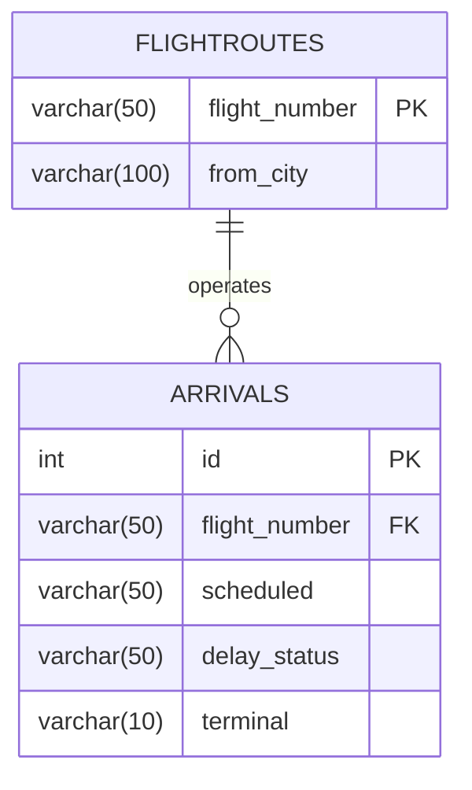

# JDBC Flight Manager (`FlightDB`)

## 1. Project Description
**JDBC_FlightManager** is a Java application connected to a normalized MySQL database (`FlightDB`) for managing and viewing arriving flights. The project demonstrates 3NF database normalization, JDBC operations (queries, single and batch updates), and SQL Injection prevention using `PreparedStatement`.

### Core Classes
* `FlightManagerBase`: Displays the full flight arrivals board using an `INNER JOIN` between `Arrivals` and `FlightRoutes`.
* `SimpleFlightUpdater`: Updates the delay status of a specific flight (`LX354`). Initially demonstrated an SQL Injection vulnerability.
* `AdvancedFlightDispatcher`: Performs batch status updates across multiple flights.
* `FlightViewer`: Prompts the user for a target terminal (2–5) and displays matching arriving flights sorted by scheduled time using a parameterized query.

---

## 2. Engineering Team Details
* **Student 1:** Noga Feldman | ID: `212146740` | Email: `Noga.Feldman@braude.ac.il`
* **Student 2:** `Selen Daher` | ID: `214228884` | Email: `Selen.Daher@braude.ac.il`
* **Course:** Software Engineering / Database Systems (Ex3)

---

## 3. Technology Stack
* **Language:** Java 
* **Database:** MySQL (`FlightDB`)
* **Database Connectivity:** JDBC (`mysql-connector-j-9.5.0.jar`)
* **IDE:** IntelliJ IDEA
* **AI Assistant:** Continue Extension
* **Version Control:** Git & GitHub

---

## 4. Database Normalization (3NF) & Functional Dependencies (F)
The raw table (`rawflights`) violated 3NF due to a transitive dependency (`id → flight_number → from_city`).

**Functional Dependencies ($F$):**
* `id → flight_number, scheduled, delay_status, terminal`
* `flight_number → from_city`

**3NF Tables:**
* **`flightroutes`** (`flight_number` **PK**, `from_city`)
* **`arrivals`** (`id` **PK**, `flight_number` **FK**, `scheduled`, `delay_status`, `terminal`)
---

## 5. Independent AI Prompt
```text
Create a Java class called FlightViewer with a main method that lets the user view arriving flights by terminal.

First, ask the user via Scanner for the MySQL root password and for a terminal number (valid options are 2, 3, 4, or 5).
Connect to my local MySQL database FlightDB (user "root", URL: "jdbc:mysql://localhost:3306/FlightDB?allowLoadLocalInfile=true&allowPublicKeyRetrieval=true&serverTimezone=Asia/Jerusalem&useSSL=false"). Make sure to use try-with-resources for Scanner, Connection, PreparedStatement, and ResultSet.

Run a secure PreparedStatement using '?' to do a SELECT INNER JOIN between the Arrivals and FlightRoutes tables (matching on flight_number), filtered by WHERE Arrivals.terminal = ? and sorted by ORDER BY Arrivals.scheduled ASC.
Bind the terminal input with pstmt.setString(1, terminal) because the terminal column is VARCHAR(10).

Finally, print the matching flights (id, flight_number, from_city, scheduled, delay_status, terminal) in a neat formatted table, or show a message if no flights were found.
```
---

## 6. Entity-Relationship Diagram (Mermaid)

---
## 7. Security Audit Summary
* **Vulnerability:** `SimpleFlightUpdater` initially used `Statement` with string concatenation, exposing it to SQL Injection.
* **Exploit:** Inputting `Landed' #` commented out the `WHERE` clause and overwrote all **299 rows** with `Landed`.
* **Fix:** Refactored to `PreparedStatement` with a `?` placeholder. Re-running `Landed' #` safely updated only **1 row** (`LX354`) with the literal string.
---

## 8. License
This project is for academic purposes and is licensed under the MIT License.